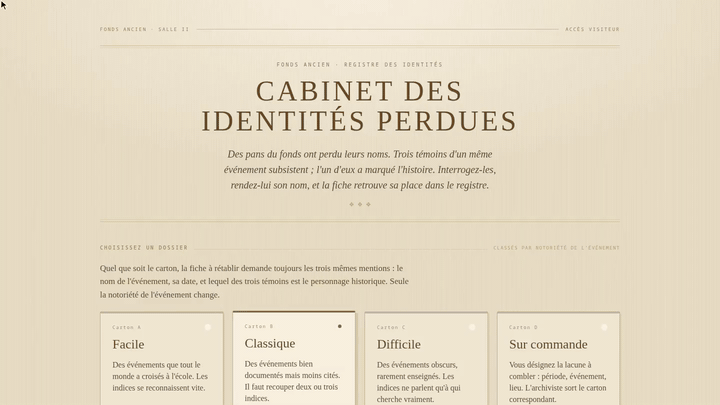
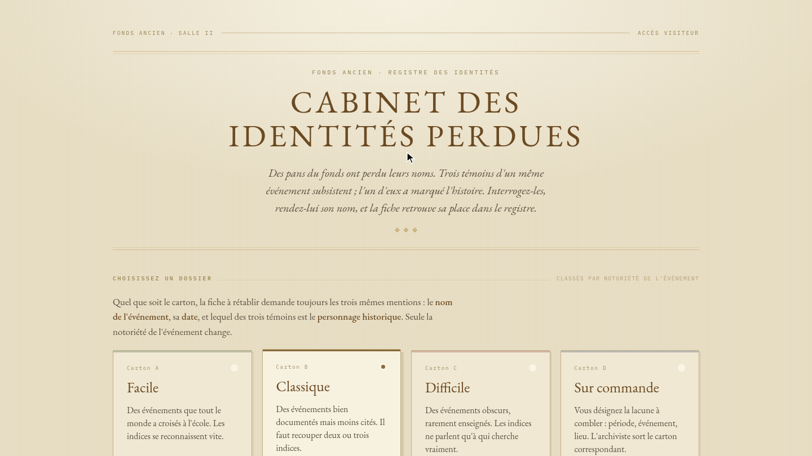
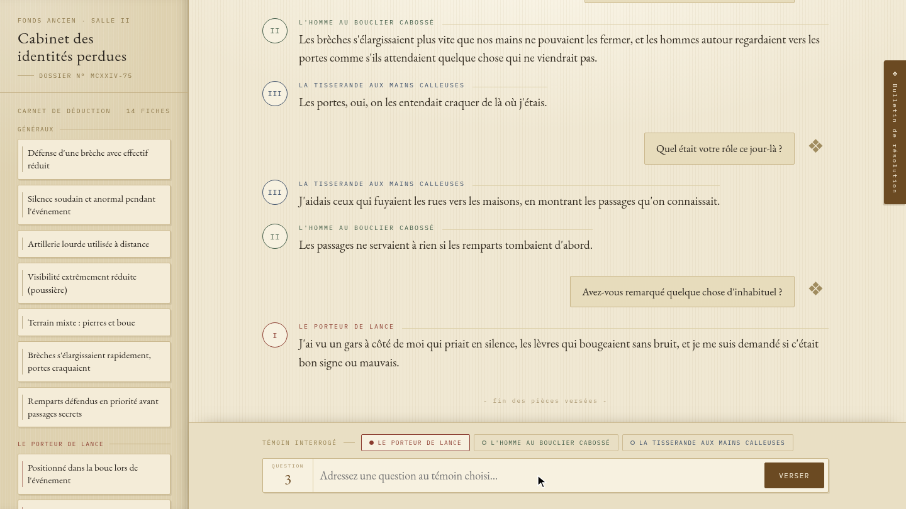
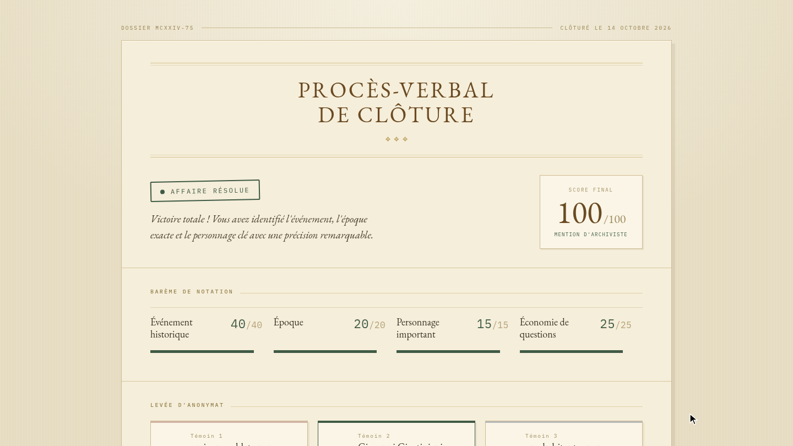
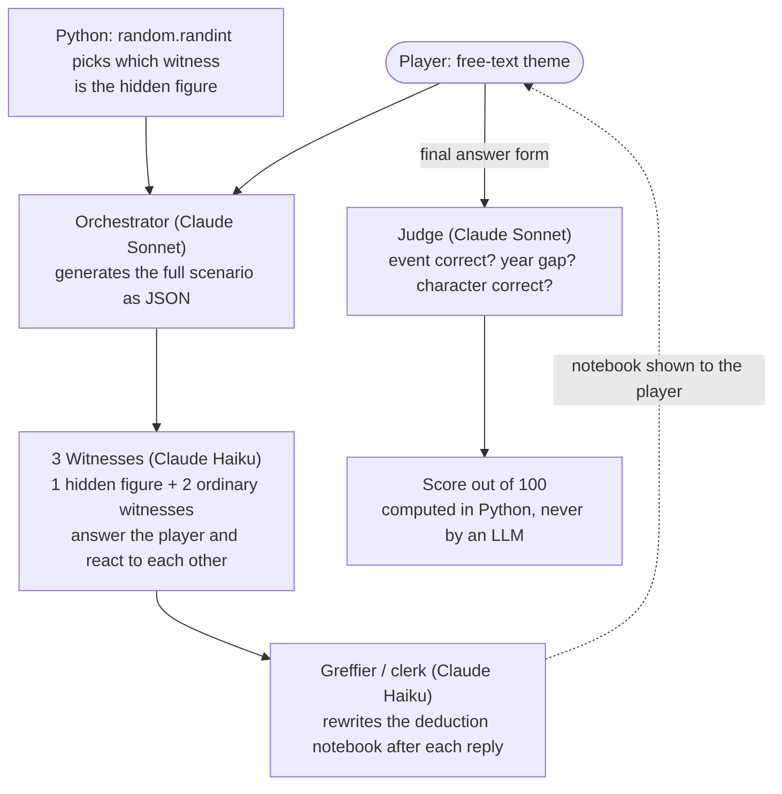

# Le cabinet des identités perdues

A historical deduction game played in natural language against a multi-agent LLM system
(Claude Sonnet and Haiku). Three witnesses of a real historical event can be questioned
freely; one of them is secretly a famous historical figure who will never say who they are,
and the player must work out the event, the date, the hidden identity and which witness it is.

Solo project, SCIA 2026 hackathon. The full write-up is in French: [`RAPPORT.pdf`](RAPPORT.pdf).

## Demo



*An example game session (about 1 minute, loading and verdict waits sped up; recorded with a scripted browser, the answers are generated live by the models).*

| Case files | Interrogation | Verdict |
|---|---|---|
|  |  |  |

## What this shows

Working with LLMs in a game loop where correctness matters, the interesting part was not the prompts but
what had to be taken *out* of the models:

- **Biases are handled in code.** An observed positional bias (the hidden figure was almost always the
  third witness) is fixed by drawing the slot in Python, not by asking the model to be random.
  The effect was observed during testing; it has not been quantified.
- **Scoring is deterministic.** The Judge LLM only returns structured judgements (event correct, year gap, character correct); the points and the total are plain Python.
- **Model output is treated as untrusted.** Redaction of forbidden names, stage-direction filtering,
  truncation detection with one retry, a fallback when a call fails.
- **The deterministic parts are tested offline** (no API call): scoring, JSON parsing, name redaction.

## Architecture



| Role | Model (default, see `src/cabinet/config.py`) | Job |
|---|---|---|
| Orchestrator | `claude-sonnet-5` | Generates the scenario: event, date, forbidden names, 3 witnesses with their system prompts |
| Witnesses (x3) | `claude-haiku-4-5` | Answer in one short sentence, first person; the non-questioned ones may react spontaneously |
| Greffier | `claude-haiku-4-5` | Maintains the player's deduction notebook (general facts + one section per witness) |
| Judge | `claude-sonnet-5` | Rates the player's event / date gap / character; does not compute any score |

Scoring (`src/cabinet/agents.py`, 100 points): event 40 (all or nothing); date 20 (15 if within
10 years, 10 within 50, 5 within 100, 3 within 200, 0 beyond); character 10 + 5 for designating
the right witness; question economy 25 (full up to 6 questions, then -2 per extra question).

## Run it

Requirements: Python 3.13+, [`uv`](https://docs.astral.sh/uv/), and an Anthropic API key
(**running a game makes real, billed API calls**).

```bash
git clone https://github.com/touikss/cabinet-des-identites-perdues.git
cd cabinet-des-identites-perdues
export ANTHROPIC_API_KEY="your-api-key"
uv run uvicorn cabinet.server:app --reload
```

Then open http://localhost:8000/. The key can also come from `ANTHROPIC_AUTH_TOKEN` or an
already configured profile. Sessions are kept in memory only. Each game is logged to
`logs/partie_*.jsonl` (git-ignored).

Model names can be overridden with `CABINET_ORCHESTRATOR_MODEL`, `CABINET_JUDGE_MODEL`,
`CABINET_WITNESS_MODEL` and `CABINET_GREFFIER_MODEL`.

## Tests and lint

The tests are fully offline (fake clients, no API call):

```bash
uv run --group dev pytest
uv run --group dev ruff check .
```

They cover the deterministic parts: scoring, JSON parsing with retry, proper-name redaction
and stage-direction stripping.

## Engineering notes

- **Positional bias, fixed in code.** During testing, the Orchestrator almost always picked the
  third witness as the hidden figure, whatever the theme (see section 2.1 of the report). The
  draw now happens in Python (`random.randint` in `generate_scenario`), the slot is imposed in the
  prompt, and the `personnage_important` field is overwritten afterwards as a safeguard.
- **The score is never computed by an LLM.** The Judge only returns booleans and a year gap;
  the points, the total and the "right witness" check are plain Python.
- **Forbidden proper names are redacted in code.** Every witness reply goes through a
  case-insensitive regex built from the Orchestrator's forbidden-name list plus the secret
  event, era and identities; matches become `[???]`. A second filter strips stage directions
  (`*...*`, parentheses, narrative prefixes). Known limit (report, section 4 and 6): exact-match
  filtering misses isolated identifying titles such as "cardinal".
- **JSON parsing with retry.** Model output is stripped of code fences and parsed; on truncation
  (`stop_reason == "max_tokens"`) or invalid JSON the call is retried once, then a `ValueError`
  is raised. If the Greffier fails, the previous notebook is kept.

## Project layout

```
src/cabinet/
  agents.py       orchestrator, witnesses, greffier, judge, scoring, redaction
  config.py       model names
  prompts.py      prompt templates
  server.py       FastAPI backend (NDJSON streaming) + static frontend
  static/         HTML/CSS/JS frontend, no build step
tests/            offline unit tests
```

Note: prompts, game text, code comments and docstrings, and the report are in French. The in-game title is still the original hackathon name, "Qui suis-je ? Temporel".

## License

Code: [MIT](LICENSE).
